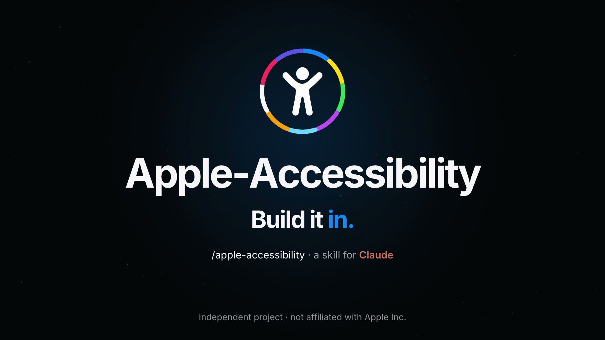
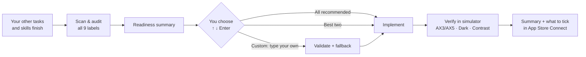

# Apple Accessibility: a Claude skill for App Store Accessibility Nutrition Labels

[](LICENSE)


**Apple Accessibility** is a skill for [Claude Code](https://claude.com/claude-code) (and Claude.ai). It audits any app headed for the App Store against Apple's **Accessibility Nutrition Labels** criteria and lets you pick which features to support. Claude implements and verifies them, then tells you exactly what to declare in **App Store Connect → App Accessibility**.

It works with SwiftUI, UIKit, AppKit, React Native / Expo, Flutter, Unity, Capacitor / Cordova, and .NET MAUI apps.

<p align="center"><i>"The developer indicated that this app supports the following accessibility features."</i><br>This skill makes sure that sentence is true.</p>

[](assets/compressed.mp4)

## Why

Since iOS 26, every App Store product page has an **Accessibility** section listing the features an app supports. The labels are a public promise to users who rely on them. Apple's rule is strict: you may claim a feature only if users can complete **all common tasks** in your app with it, including onboarding, login, purchase, and settings. App Review can ask you to correct labels that are misleading.

Getting there by hand means reading nine sets of evaluation criteria, auditing every screen, and fixing layouts at 200%+ text size. You also have to tame animations, check contrast ratios, and remember to declare the result. This skill does that work with you, and it is conservative: **it would rather leave a label unclaimed than let you claim one that doesn't pass.**

## The nine labels

| Label | What the skill checks and builds |
|---|---|
| **VoiceOver** | Labels, traits, values, custom actions, focus order, modals, custom controls |
| **Voice Control** | "Show names / numbers", labels match visible text, input labels, gesture alternatives |
| **Larger Text** | Dynamic Type to ≥ 200% (AX3+), adaptive stacks, wrapping, scrolling, Large Content Viewer |
| **Dark Interface** | Dark Mode on every common-task screen, no white flashes (launch, sheets, web views, artwork) |
| **Differentiate Without Color Alone** | Icons, text, and shapes alongside colour; charts; grayscale test |
| **Sufficient Contrast** | WCAG 4.5:1 text / 3:1 non-text, Increase Contrast palettes, Reduce Transparency |
| **Reduced Motion** | Zoom, scale, spin, and parallax replaced by fades; decorative loops stopped |
| **Captions** | On by default with the system setting; subtitles, SDH, transcripts |
| **Audio Descriptions** | AD track auto-selected; descriptions for cut scenes and visual-only hints |

## How it works



### 1. It runs last, on purpose
Use it in the same prompt as other skills:

> *Build me a heart-rate monitoring app using the apple-accessibility skill, the apple-design skill and the swift-charts skill.*

Claude adds an **"Apple Accessibility pass"** as the final step and finishes everything else first. An accessibility audit of a half-built app goes stale with the next screen. Fixes made early get overwritten by later feature work.

### 2. It audits, then shows you a readiness summary

```
| Feature              | Status              | Work   | Why                                         |
|----------------------|---------------------|--------|---------------------------------------------|
| Dark Interface       | ✅ Ready            | verify | Semantic colours everywhere                 |
| Reduced Motion       | 🟢 Achievable       | Small  | 3 zoom/scale transitions need fades         |
| Larger Text          | 🟢 Achievable       | Medium | Onboarding clips at AX3; fixed 54pt buttons |
| Sufficient Contrast  | 🟠 Not recommended  | Large  | Brand grey is 2.5:1 on white                |
| Captions             | ⚪ N/A              | –      | No video or spoken audio                    |
```

### 3. You choose with the arrow keys, without leaving the session

```
Which accessibility features should I implement?

❯ 1. All recommended (3)   Dark Interface, Reduced Motion, Larger Text
  2. Best two              Dark Interface + Reduced Motion: fastest to genuinely pass
  3. Other                 type your own selection
```

- **All recommended**: every feature that is ready, or achievable with concrete work.
- **Best two**: the two with the best ratio of users helped to risk of not passing.
- **Custom**: type anything ("dark mode and screen reader"). The skill maps it to the official labels. If a choice falls outside the recommendations, it explains why and offers a **fallback**: best-effort improvements without claiming the label, a swap for the closest recommended feature, or the full effort if you accept the scope.

### 4. It implements, verifies, and says what it couldn't verify
It builds shared helpers first (motion-aware animations, adaptive stacks, scroll-if-needed containers, contrast-safe palettes) so every screen adapts the same way. It leaves your default design untouched, then verifies in the simulator at AX3/AX5, in Dark + Increase Contrast, and against a default-settings regression screenshot. Motion, VoiceOver speech, and captions can't be seen in a screenshot, so for those it tells you plainly that they were verified in code, and gives you a one-minute on-device check.

### 5. It tells you what to declare, and reminds you to do it

```
| Feature        | iPhone     | iPad       |
|----------------|------------|------------|
| Larger Text    | ✅ Yes     | ✅ Yes     |
| Dark Interface | ✅ Yes     | ✅ Yes     |
| VoiceOver      | ⬜ Not yet | ⬜ Not yet |
| Captions       | ⚪ N/A     | ⚪ N/A     |
```

> 📱 **Don't forget App Store Connect.** Go to **Apps → your app → App Accessibility → Get Started**, add support per device, tick the features above, then **Save** and **Publish**.

It also writes an Accessibility section into your README and can draft an `/accessibility` page for the optional Accessibility URL.

## Installation

Pick **one** of these.

### Option A: Claude Code plugin (recommended)

Run these two commands **inside Claude Code** (they're Claude Code commands, not shell commands):

```text
/plugin marketplace add fadhiljr7/apple-accessibility
/plugin install apple-accessibility@apple-accessibility
```

Restart Claude Code if it was already open. Update later with `/plugin marketplace update apple-accessibility`.

### Option B: Personal skill (all your projects)

```bash
git clone https://github.com/fadhiljr7/apple-accessibility.git
```

```bash
mkdir -p ~/.claude/skills && cp -r apple-accessibility/skills/apple-accessibility ~/.claude/skills/
```

### Option C: One project only

From your app's project folder:

```bash
mkdir -p .claude/skills && cp -r /path/to/apple-accessibility/skills/apple-accessibility .claude/skills/
```

Commit `.claude/skills/apple-accessibility` so everyone on the team gets it.

### Option D: Claude.ai

Zip the `skills/apple-accessibility` folder and upload it in **Claude.ai → Settings → Capabilities → Skills**. The workflow is the same. Without the arrow-key picker, the three choices appear as a numbered list you answer with 1, 2 or your own words.

### Check that it's installed

In Claude Code, type `/apple-accessibility`. If the skill appears in the list, it's ready.

## How to use

Mention accessibility, the App Store's accessibility labels, or the skill by name. Claude loads it automatically. You can also call it directly with `/apple-accessibility`.

Every run follows the same path: **scan → readiness summary → you choose (↑ ↓ ⏎) → implement → verify → what to declare in App Store Connect.**

### Use case 1: Build a new app, and accessibility runs last

```text
Build me a heart-rate monitoring app in SwiftUI using the apple-accessibility skill and apple-design.
```

Claude adds **"Apple Accessibility pass"** as the final task and builds everything else first. Once the app compiles, it audits the finished app, shows the readiness summary, and asks which features to implement. You never audit a half-built app twice.

### Use case 2: Audit an app you've already shipped

```text
/apple-accessibility
Which App Store accessibility labels can my app honestly claim right now?
```

Claude runs `scan_app.py` and reads the flagged code. Where it can, it checks screens in the simulator at AX3/AX5 text, Dark Mode and Increase Contrast. It then rates all nine labels as **✅ Ready, 🟢 Achievable, 🟠 Not recommended now or ⚪ Not applicable**, with evidence for each. Labels that are already **Ready** only need verifying, so they're free to claim.

### Use case 3: Choose what to implement: all, best two, or your own pick

After the summary, Claude asks:

```text
Which accessibility features should I implement?
❯ 1. All recommended (5)   Dark Interface, Reduced Motion, Differentiate…, Contrast, Larger Text
  2. Best two              Dark Interface + Reduced Motion: the fastest to genuinely pass
  3. Other                 Type your own selection
```

Use **↑ ↓** and **Enter**, or choose **Other** and type something like `dark mode + voiceover`. Each request is mapped to an official label. If something falls outside the recommendations, you get an honest **fallback**: improve it now without claiming the label, swap it for the closest recommended feature, or take on the full work if you accept the scope.

### Use case 4: A cross-platform app (React Native, Expo, Flutter, Unity…)

```text
My Expo app is going to the App Store next week. Add Larger Text and Dark Interface support with apple-accessibility.
```

The skill detects the stack and uses that stack's APIs: `useColorScheme`, `DynamicColorIOS` and `allowFontScaling` for React Native; `ThemeMode.system`, `MediaQuery.textScalerOf` and `Semantics` for Flutter. It also catches stack-specific traps, such as an Expo `app.json` with `"userInterfaceStyle": "light"`, which forces light mode and fails Dark Interface.

### Use case 5: Before you submit, know exactly what to tick in App Store Connect

```text
I'm about to upload version 2.0. Re-check accessibility and tell me what to declare in App Store Connect.
```

Claude re-verifies every label you claimed before. Labels must stay accurate with every update. It then gives you the per-device table (iPhone / iPad / Mac…) of what to tick, plus the reminder: **App Store Connect → Apps → your app → App Accessibility → Get Started / Edit → tick the features → Save → Publish.** The skill never submits anything for you. You declare it when you upload.

## What's inside

```
assets/                         # Launch film (compressed.mp4) + poster used in this README
skills/apple-accessibility/
├── SKILL.md                    # The workflow: timing, audit, choice, implement, verify, declare
├── references/
│   ├── criteria.md             # Apple's criteria for all 9 labels, condensed, with pass/fail
│   ├── apple-native.md         # SwiftUI / UIKit / AppKit patterns
│   ├── cross-platform.md       # React Native, Expo, Flutter, Unity, web views, MAUI
│   ├── verification.md         # Test matrix, simulator commands, performAccessibilityAudit
│   └── app-store-connect.md    # Declaring labels, Accessibility URL, closing reminder
└── scripts/
    ├── scan_app.py             # Static triage of any project (stdlib Python 3)
    ├── contrast.py             # WCAG contrast ratio + nearest passing colour
    └── sim_a11y.sh             # Toggle simulator text size / dark / contrast, screenshots
```

The scripts work on their own too:

```bash
python3 skills/apple-accessibility/scripts/scan_app.py ~/Projects/MyApp
python3 skills/apple-accessibility/scripts/contrast.py "#93A4B8" "#FFFFFF"
# FAIL   2.55:1  #93A4B8 on #FFFFFF  (target 4.5:1)  → try #6B7886 (27% mix)
skills/apple-accessibility/scripts/sim_a11y.sh stress    # AX3 + Dark + Increase Contrast
```

## Requirements

- Claude Code (any recent version), or Claude.ai with skills enabled
- For verification: macOS with Xcode and the iOS Simulator (the audit and implementation work without them, but visual checks are skipped and reported as such)
- Python 3 for the helper scripts (standard library only)

## Principles

1. **Honest labels over more labels.** A label is recommended only when every common task passes.
2. **Default design stays intact.** Adaptations kick in only when the user's setting asks for them.
3. **Replace meaning, remove decoration.** Meaningful motion becomes a fade; decorative loops stop.
4. **Wrap, don't truncate.** Rows become columns, chips wrap, fixed heights become minimums, pages scroll.
5. **Measure, don't eyeball.** Contrast is calculated against worst-case backgrounds.
6. **Say what wasn't verified.** Code-verified and screen-verified are reported separately.

## Sources

Built from Apple's official documentation:

- [Overview of Accessibility Nutrition Labels](https://developer.apple.com/help/app-store-connect/manage-app-accessibility/overview-of-accessibility-nutrition-labels/)
- Evaluation criteria: [VoiceOver](https://developer.apple.com/help/app-store-connect/manage-app-accessibility/voiceover-evaluation-criteria) · [Voice Control](https://developer.apple.com/help/app-store-connect/manage-app-accessibility/voice-control-evaluation-criteria) · [Larger Text](https://developer.apple.com/help/app-store-connect/manage-app-accessibility/larger-text-evaluation-criteria) · [Dark Interface](https://developer.apple.com/help/app-store-connect/manage-app-accessibility/dark-interface-evaluation-criteria) · [Differentiate Without Color Alone](https://developer.apple.com/help/app-store-connect/manage-app-accessibility/differentiate-without-color-alone-evaluation-criteria) · [Sufficient Contrast](https://developer.apple.com/help/app-store-connect/manage-app-accessibility/sufficient-contrast-evaluation-criteria) · [Reduced Motion](https://developer.apple.com/help/app-store-connect/manage-app-accessibility/reduced-motion-evaluation-criteria) · [Captions](https://developer.apple.com/help/app-store-connect/manage-app-accessibility/captions-evaluation-criteria) · [Audio Descriptions](https://developer.apple.com/help/app-store-connect/manage-app-accessibility/audio-descriptions-evaluation-criteria)
- [Manage Accessibility Nutrition Labels](https://developer.apple.com/help/app-store-connect/manage-app-accessibility/manage-accessibility-nutrition-labels)

Its implementation patterns come from shipping these labels in real apps (a habit tracker and an ambient soundscape app). Apple's criteria change over time. If something here disagrees with Apple's current pages, Apple wins, so please open an issue.

## Contributing

Issues and pull requests are welcome, especially:
- patterns for more frameworks (Compose Multiplatform, Godot, …)
- new scanner rules and fewer false positives in `scan_app.py`
- updates when Apple revises the evaluation criteria

Keep `SKILL.md` under ~500 lines and put detail in `references/`.

## Disclaimer

This is an independent project. It is not affiliated with or endorsed by Apple Inc. Apple, App Store, VoiceOver, and the other names mentioned are trademarks of Apple Inc. The skill helps you evaluate and implement accessibility features. You remain responsible for the accuracy of the labels you declare in App Store Connect.

## License

[MIT](LICENSE)
